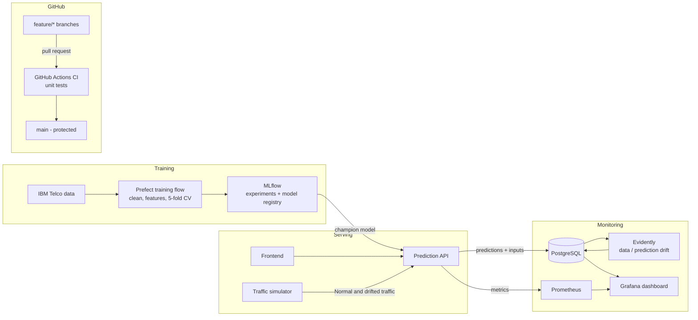
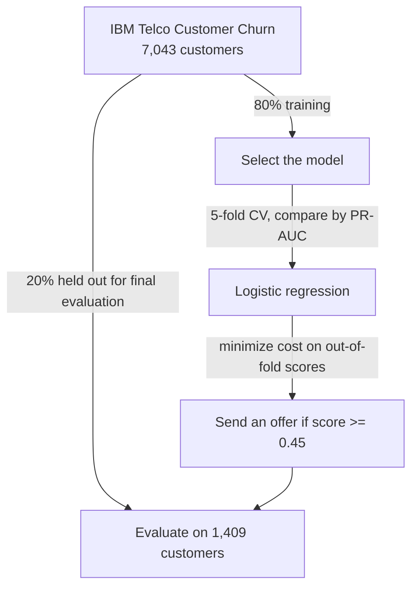

# Telco Customer Churn Prediction

INSY 684 group project, McGill MMA (Fall 2026).

Team: Alex Zhao, Yanbing Zhao, Asma Sardar, Fatima Ali, Cara Yu, Liz Li, Esteban Shen

We predict which telecom customers are likely to cancel their service, so the retention team can send offers to the riskiest customers first. The data is the IBM Telco Customer Churn dataset (7,043 customers, about 26.5% churn). This continues our project from the first course.

## Software architecture

Written in Mermaid (diagram as code), GitHub renders it directly. It will change as we build the project.



## Modeling approach



## Repository layout

```
src/churn/
    config.py      paths, column lists, threshold, MLflow names
    data.py        load, clean and split the data
    features.py    preprocessing pipeline
    models.py      candidate models, CV and evaluation metrics
    train.py       trains the models, logs them to MLflow, registers the best one
scripts/
    download_data.py
tests/             unit tests, run by CI on every push and pull request
.github/workflows/ci.yml
```

## How to run

```bash
python -m venv .venv
source .venv/bin/activate        # Windows: .venv\Scripts\activate
pip install -r requirements.txt
pip install -e .

python scripts/download_data.py  # no Kaggle account needed
pytest                           # unit tests
python -m churn.train            # 3 models, picks the best by CV PR-AUC
mlflow ui --backend-store-uri sqlite:///mlflow.db
```

Then open http://127.0.0.1:5000 to see the runs under the `telco-churn` experiment and the registered model `telco-churn-classifier` (alias `champion`) under Models.

## Data notes

- `TotalCharges` comes in as text because 11 new customers (tenure 0) have a blank value. They haven't been billed yet, so we set it to 0 instead of imputing a median.
- `customerID` is dropped since it is only an identifier.
- All preprocessing is inside the sklearn Pipeline, so it is fitted on training folds only and nothing leaks from the test set.

## How we work

- `main` is protected: no direct pushes, changes go through a pull request, CI has to pass and one teammate approves.
- Everyone works on their own `feature/<task>` branch.
- Small commits with clear messages, since the commit history is part of the grade.

Feature branches:

- `feature/mlflow-experiments` (Cara)
- `feature/prefect-training-flow`
- `feature/frontend`
- `feature/monitoring` (Alex) - Evidently + PostgreSQL
- `feature/grafana-dashboard` - Prometheus + Grafana
- `feature/traffic-simulator` - drift injection
